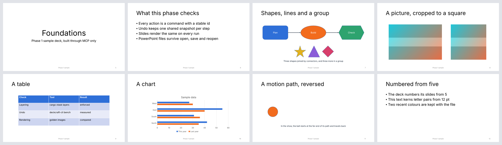

# Phase 1 report: foundations

> **Date:** 2026-11-18 · **Branch:** `claude/new-session-lm99ab` · **Base:** upstream `main` v0.19.0 merged into the fork (`86be392`)

## 1. What shipped



- **Base moved.** Upstream `main` (v0.19.0, 132 commits) is merged into the fork with no
  conflicts. Every fork patch test and `cargo xtask ci` pass on the result.
- **Golden-image harness.**
  - `deckcraft_render::golden` compares a render with a stored picture (a per-channel tolerance
    and a share of the picture), draws a diff picture and decodes stored PNGs.
  - `crates/engine/tests/it/golden.rs` renders the built-in sample and every
    `samples/*.deckcraft`, slide by slide, against `samples/golden/<deck>/slide-NN.png` (16
    pictures today).
  - A failing slide writes its render and a diff under `target/tmp/golden/`.
    `DECKCRAFT_BLESS_GOLDEN=1` rewrites the pictures.
  - The test is skipped on builds without craft-fonts, and fails on them when
    `CRAFT_FONTS_REQUIRED` is set.
- **`.pptx` round trip by pixels.** `crates/engine/tests/it/pptx_roundtrip.rs` sends each sample
  deck through `.pptx`. The reopened deck must keep its slides, text, shapes, notes, animations
  and transitions, save the same way a second time, and still match its golden pictures.
  `DECKCRAFT_PPTX_CORPUS=<folder>` runs the same check with a loss report over decks kept outside
  the repository; that is where the ten real-world decks go.
- **Command registry audit** ([`command-audit.md`](../command-audit.md)). Three new tests:
  - the 43 queries and 59 non-undo commands are pinned with a reason each;
  - all of them leave the deck alone (one intended exception, `format.recentColor`);
  - the UI, MCP and apps change documents only through commands.
- **Undo measured.** `deckcraft-cli bench` now times moving a shape, undoing it and restyling
  every slide, and reports the memory one undo step keeps.
- **Sample deck built only through MCP.** `samples/phase-1.deckcraft` is written by
  `crates/mcp/tests/it/phase1_sample.rs` from `tools/call` requests alone. It covers:
  - slides, text, shapes and connectors, a group, two pictures, a table, a chart, a motion path
    and a Morph transition;
  - the fork-patch commands: crop to a ratio, reverse a path, number slides from 5, kern from
    12 pt, recent colours.

  The test checks the stored file is what the script builds, that two runs agree, and that
  each patch command's effect is in the saved deck. It renders headlessly:

```bash
deckcraft-cli render samples/phase-1.deckcraft --all --scale 1 out/
```

## 2. Ported and re-implemented

Nothing was ported: the host already had enforced layering, a command registry of the
DesignCraft design, and copy-on-write undo. What was missing was built here: the comparison
harness, the round-trip suite and the audit tests. The reasons are in
[`porting-log.md`](../porting-log.md).

## 3. Tests, benchmarks and round trips

| Check | Result |
|---|---|
| `cargo xtask ci` (fmt, pdf-deps, clippy, test, doctest, assets, layers, wasm) | All 8 steps passed; 2,348 tests passed, 0 failed |
| Fork patch tests | Pass (part of the above) |
| Golden images, 2 decks, 16 slides | Pass; a swapped picture fails with 41.7% of pixels different |
| `.pptx` round trip of both sample decks, by structure and by pixels | Pass, no losses |
| External corpus hook, tried on two decks we generated | 0 losses each. The ten real-world decks have not been run: they are not in this environment |
| Every new feature reachable from MCP | The sample deck is built from MCP calls only |

Performance, measured with `deckcraft-cli bench --runs 9` on a 100-slide deck (the built-in
sample's eight slides, duplicated), in a 4-vCPU Linux container:

| Step | `.deckcraft` | `.pptx` | Budget |
|---|---|---|---|
| Open | 7.0 ms | 15.8 ms | 1,500 ms ✔ |
| Render all 100 slides at 1× | 187 ms | 193 ms | — |
| Move one shape (one undo step) | 0.015 ms | 0.019 ms | — |
| Undo | < 0.001 ms | < 0.001 ms | — |
| Restyle every slide (a theme accent colour) | 0.12 ms | 0.18 ms | 100 ms for a variable mode switch (Phase 4) |
| Memory one undo step keeps, one shape moved | 27 KiB | 31 KiB | — |
| Memory one undo step keeps, theme changed | 168 KiB | 370 KiB | — |
| Peak memory | 234 MiB | 232 MiB | — |

On the 8-slide sample, moving one shape keeps 21 KiB. A step therefore costs about one slide
whatever the deck's size: undo is already O(1) in the deck. The memory figures are the engine's
estimates (`undo_cost`), not measured heap. Changing the theme is cheap; what costs is
re-drawing afterwards (about 1.9 ms a slide at 1×, about 0.6 ms at thumbnail size), so the Phase 4
budget is mostly a rendering budget. 60 fps pan and zoom cannot be measured in this container
(no display, software GPU) and was not.

## 4. Known gaps and risks for the next phase

- **Real-world decks.** The `.pptx` acceptance check names ten real decks. The suite is ready for
  them but they need to be supplied outside the repository:

  ```bash
  DECKCRAFT_PPTX_CORPUS=/path/to/decks cargo test -p deckcraft-engine --test it external_corpus -- --nocapture
  ```

- **Golden pictures across machines.** They were blessed on Linux x64. `vello_cpu` picks SIMD
  per machine, so macOS ARM may differ at edges. The tolerance allows for that, but it has not
  been seen on another machine yet. If it fails there, the fix is the tolerance, not a re-bless.
- **Repository size.** The 16 golden PNGs are 1.1 MB. Each new sample deck adds about 70 KB a
  slide at 1×.
- **UI-only commands.** 53 window-state commands (views, panes, dialogs, the show) need a running
  app. That doesn't block building decks, but Phase 3's Grid view needs a decision on whether the
  view mode is document or window state.
- **Phase 2 risk.** A new text composer changes line breaks, which changes the golden pictures by
  design. Re-blessing then needs a person to look at every changed slide. The diff pictures exist
  for that.
- **Build disk.** A full `cargo xtask ci` with incremental builds filled this container's disk
  allowance (28 GB of `target/`). CI here now runs with `CARGO_INCREMENTAL=0`.

## 5. Decisions

Answered 2026-11-18 ([`decisions/001-product-identity.md`](../decisions/001-product-identity.md)):
the real-world decks go to a separate public repo, `Offset54/slidecraft-pptx-corpus` (changed 2026-11-19 from a private folder); work continues on this
branch; the product is SlideCraft (`io.github.offset54.slidecraft`, `.slidecraft`). Still open:
the image-generation bridge, and the installer identity step described in that record.
