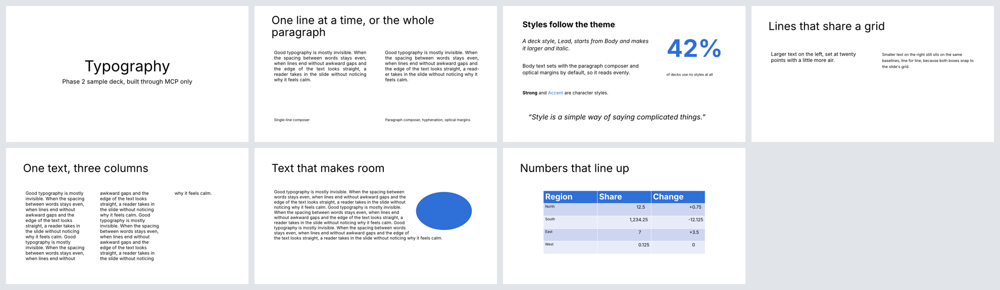
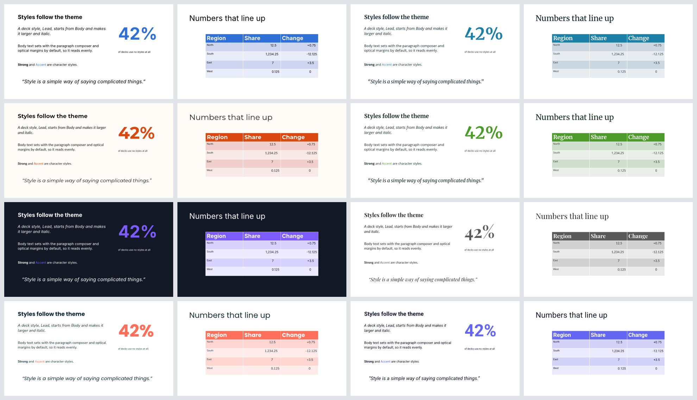

# Phase 2 report: typography

> **Date:** 2026-11-23 · **Branch:** `claude/new-session-lm99ab` · **Commits:** `a171a80` (P2.1) ·
> `c8017a2` (P2.2) · `e37e1f1` (P2.3) · `67000ea` (P2.4) · `51138d3` (P2.5) · `6dd85cf` (P2.6) ·
> the sample deck and this report in the commit after

## 1. What shipped



Every feature below is a command (so the GUI, CLI, control channel and MCP reach it), is one undo
step, is saved in `.deckcraft`, round-trips through `.pptx`, and is off unless a deck turns it on.
That last point means no existing deck and no `.pptx` lays out differently: the built-in and
Phase 1 golden pictures did not change.

| Arc | What | Command | GUI |
|---|---|---|---|
| P2.1 | **Paragraph composer** (Knuth–Plass total fit) for even spacing; **hyphenation** (US English); **optical margin alignment** (punctuation hangs into the margin) | `format.typography` | Home › Paragraph › Line Spacing |
| P2.2 | **Paragraph and character styles** bound to the theme: Title, Subtitle, Heading, Body, Caption, Quote, Big Number; Strong, Emphasis, Accent; deck styles with `basedOn` | `style.list`, `style.apply`, `style.define`, `style.matchSelection`, `style.delete` | Home › Paragraph › Text Styles |
| P2.3 | **Baseline grid** on a slide, layout or master; paragraphs opt in | `design.baselineGrid`, `format.typography {snapToGrid}` | Design › Baseline Grid |
| P2.4 | **Threaded text**: text a box cannot hold continues in the next box | `text.threadTo`, `text.unthread` | Shape Format › Link Text Boxes |
| P2.5 | **Text wrap** around a shape's bounding box | `arrange.textWrap` | Shape Format › Arrange › Wrap |
| P2.6 | **Pro tables**: per-column alignment, **alignment on the decimal point**, column and header-row paragraph styles | `table.columnFormat`, `table.headerStyle` | Layout › Column |

The sample deck, [`samples/phase-2.deckcraft`](../../samples/phase-2.deckcraft), is built only by
MCP `tools/call` requests (`crates/mcp/tests/it/phase2_sample.rs`). The test checks that the
stored file is what the script builds, that two runs agree, and that each feature's settings are
in the saved deck. It renders headlessly:

```bash
deckcraft-cli render samples/phase-2.deckcraft --all --scale 1 out/
```

**Design check.** The layout library arrives in Phase 4, so the brief's contact sheet of layouts
by theme isn't possible yet. Instead, here are the styles slide and the table slide of the sample
in every built-in theme, Nocturne (dark) included. The styles take each theme's fonts and
colours, and nothing clips or overflows:



That check found one problem: the sample script first gave its text boxes an explicit dark colour,
which made the styles slide unreadable in Nocturne. The script now leaves colour to the theme. A
coloured style (Big Number, Accent) that would have under 3:1 contrast on its shape's fill falls
back to the shape's text colour (P2.2). That is WCAG's minimum for large text; there is no full
WCAG AA audit yet.

## 2. Ported and re-implemented

Details and reasons for each item are in [`porting-log.md`](../porting-log.md).

- **Depended on:** `craft-text` from `craft-libs` (Knuth–Plass line breaking and US English
  hyphenation), at the revision the workspace already pins. DesignCraft's `compose` takes its own
  `Document` and could not be lifted (recon §1).
- **Copied:** DesignCraft's optical-margin protrusion table (credited in `NOTICE`).
- **Re-implemented against the host model:** the item builder for the composer; styles; baseline
  grid; threads; wrap; column formats. DesignCraft's equivalents served as the behavioural
  reference.

You did not choose between shared crates and copies (open decision 1), so Phase 2 used the
recommendation, the shared crate.

## 3. Tests, benchmarks and round trips

| Check | Result |
|---|---|
| `cargo xtask ci` (fmt, pdf-deps, clippy, test, doctest, assets, layers, wasm) at the last commit | All 8 steps passed; 2,409 tests passed, 0 failed (2,352 at the start of Phase 2) |
| Fork patch tests | Pass (part of the above). Two Phase 2 GUI additions first widened the ribbon enough to break UI tests: a fork-patch test (Recent Colors at 1440 px) and an upstream one (Crop at 1280 px). The new controls were made narrower; the tests were not changed |
| Golden images: built-in, Phase 1, Phase 2 (7 new pictures) | Pass. The built-in and Phase 1 pictures are byte-identical to before Phase 2 |
| `.pptx` round trip of the three sample decks, by structure and pixels | Pass. It caught a Phase 2 bug before commit: a thread saved without flowing came back with two empty paragraphs added |
| The ten real-world decks (`Offset54/slidecraft-pptx-corpus` at `eb77646`) | No crash. The same five decks lose the same things as the baseline (1, 10, 2, 8 and 23 losses). Phase 2 changes nothing on them; the fixes are on the corpus branch (§5) |
| Every new feature reachable from MCP | The sample deck is built from MCP calls only |

Tests that fail without their feature were confirmed for the composer (three tests), wrap under
middle anchoring, and decimal alignment.

**Performance**, `deckcraft-cli bench --runs 9`, release build, 4-vCPU Linux container:

| Deck | Open | Draw all at 1× | Save `.pptx` | Reopen `.pptx` |
|---|---|---|---|---|
| 101 slides, two full justified passages each, single-line composer | 4.5 ms | 410 ms | 9.0 ms | 8.6 ms |
| The same with the paragraph composer, hyphenation and optical margins | 4.5 ms | 476 ms | 7.5 ms | 7.5 ms |
| `samples/phase-2.deckcraft` (7 slides) | 1.2 ms | 17 ms | 3.0 ms | 2.9 ms |

On this deliberately dense deck, the composer costs about 16% in drawing time, or 0.65 ms per
slide. The open budget (100 slides under 1.5 s) holds with a wide margin. 60 fps pan and zoom
can't be measured in this container, and variable mode switching is Phase 4.

## 4. Known gaps and risks

**Limits of what shipped:**
- **Hyphenation** is US English only. Other languages' patterns carry licences outside the
  allowlist; text tagged with another language is not hyphenated.
- **The composer** leaves paragraphs with tabs, and vertical text, to the single-line breaker.
  Letter-spacing and glyph-scaling justification tiers are not used. The brief's "auto-fit that
  tries composer tweaks first" is not done.
- **Threads:** at most 16 boxes, on one slide, top-level shapes only. Numbered lists restart in
  each box. While the first box is being edited, it shows the whole text, and the following boxes
  repeat the overflow.
- **Wrap:** bounding box only (no contour); unrotated shapes; one column; horizontal text. Line
  positions are estimated at the paragraph's line pitch, so mixed sizes in a paragraph can graze
  an obstacle.
- **Baseline grid:** unrotated boxes, horizontal text. Shapes inside groups snap by their own
  coordinates.
- **Decimal alignment** uses '.' as the separator. In `.pptx`, PowerPoint gets right alignment
  without the padding.
- **What PowerPoint shows:** line breaks differ in PowerPoint, which has its own breaker. Styles,
  thread portions and column alignment are written as direct formatting, so PowerPoint shows the
  same text and formatting. Text wrap and the grid are SlideCraft-only. In every case, the saved
  text is unchanged.
- **Not in Phase 2:** OpenType features and variable font axes (§3 of the brief), bidi
  hyphenation, and a dialog for editing a style (today: `style.define` or "Update Style to Match
  Selection").

**Risks for Phase 3:**
- **Upstream moved the `.pptx` reader and writer into the shared `craft-pptx`** (`05d9907`, one
  of 123 upstream commits since v0.19.0). Phase 2 added extensions in `crates/pptx`. The changes
  are small and in a few places, but the next upstream merge will need them carried into
  `craft-pptx` or kept as a fork patch.
- **The corpus branch** (`claude/pptx-corpus-losses`) edits `crates/pptx/src/write.rs` next to
  Phase 2's presentation-extension change. Merging it needs one small manual resolution.
- **Ribbon width:** every new control competes for space at 1280–1440 px. Phase 3's canvas tools
  should go in panes or menus, not new ribbon buttons.
- **A commit message error:** the P2.2 commit message says it stopped serialising unset typography
  fields, but that change landed in P2.1. Pushed history was left as it is.

## 5. Decisions for the owner

1. **Phase 3 go-ahead.** Canvas and layout: FigCraft's selection, guides, frames, auto layout,
   vector networks and Grid view.
2. **Document tree** (open decision 2). Keep the nested shape tree or move to a flat node map.
   Recommended: keep the tree. This needs a decision record before Phase 3 starts.
3. **Composer by default.** Today the paragraph composer is used only where a deck or style asks
   for it. The built-in Body, Caption and Quote styles do; new decks' masters don't. Should new
   decks default to it? Recommended: yes for body placeholders in new decks; never for imported
   `.pptx`. *Decided 2026-11-23: yes. New decks' master body levels use it; imported masters are
   untouched; paragraphs with East Asian hanging punctuation keep the single-line breaker.*
4. **The corpus branch.** Its session finished the fixes, pushed them, and is waiting for you on
   two things: whether to add coverage decks to the corpus repo, and whether to squash its red
   commit `3d08904` into `f9e73f1`. After that, merge `claude/pptx-corpus-losses` here (one small
   conflict, above).
5. **Upstream merge timing.** Move onto upstream `main` (with `craft-pptx`) before Phase 3, or
   later. Recommended: before Phase 3, while the fork's `.pptx` changes are still few.
6. Still open from before: collaboration, the image-generation bridge, and the installer identity
   step.
