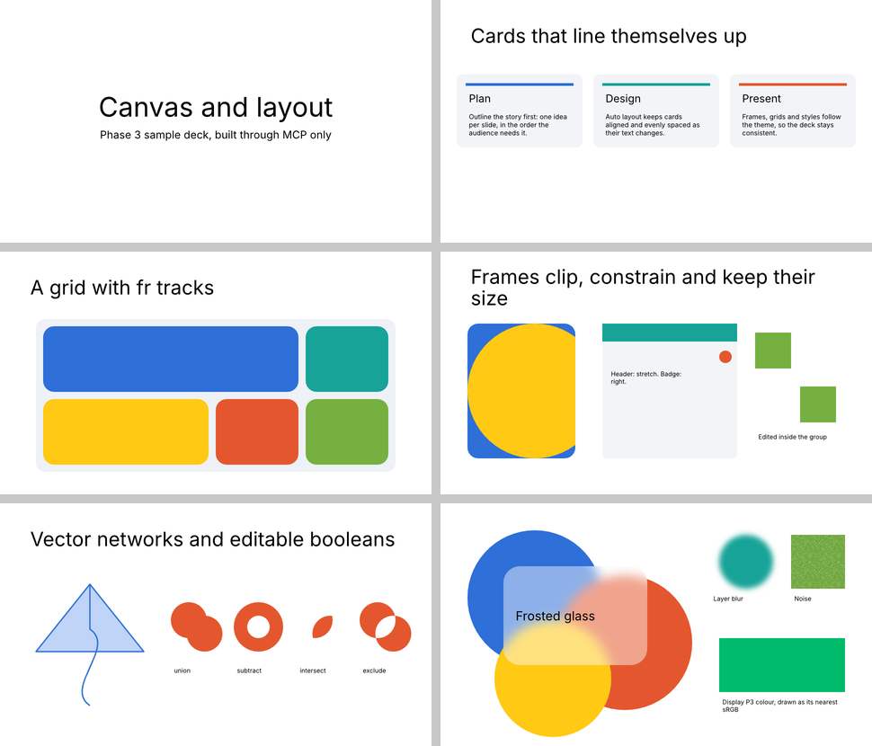

# Phase 3 report: canvas and layout

> **Date:** 2026-11-24 · **Branch:** `claude/phase-3-canvas` (from `claude/new-session-lm99ab` at
> `0aa2a75`) · **Commits:** `871dd2c` (P3.1–P3.4) · `629d6d4` (P3.5–P3.8) · `050fd81` (merge of
> `claude/new-session-lm99ab`: decision 004, composer default) · the `.pptx` side, the sample
> deck and this report in the commit after

## 1. What shipped



Every feature below is a command (so the GUI, CLI, control channel and MCP reach it), is one undo
step, is saved in `.deckcraft`, and round-trips through `.pptx`. All new fields are absent unless
used, so existing decks and `.pptx` files are unchanged: every earlier golden picture is
byte-identical.

| Arc | What | Commands | GUI |
|---|---|---|---|
| P3.1 | **Grid view and single-slide view**, one keystroke apart. The view is window state ([decision 003](../decisions/003-view-mode.md)). Grid view is the host's Slide Sorter: sections, drag to reorder, multi-select, zoom | `view.grid` (UI command, Cmd/Ctrl+Alt+B) | View menu |
| P3.2 | **Editing inside groups** without ungrouping: Enter selects a group's members, Shift+Enter or Esc goes back up, a double-click goes in, and once inside, clicks pick members. **Distance measurement**: hold Alt over the canvas | `edit.selectChildren`, `edit.selectParent`, `arrange.measure` (query) | Arrange menu; Format pane › Size › Frame & Layout |
| P3.3 | **Frames**: a group with its own box (fill, outline, effects, corner radius), optional clipping, that keeps its size when its members move. **Constraints**: start, end, both (stretch), centre, scale | `frame.create`, `frame.set`, `layout.constraints` | Arrange menu; Format pane |
| P3.4 | **Auto layout**: horizontal and vertical flow, wrap, grid with fixed / hug / `fr` tracks and spanning cells, hug / fill / fixed sizing, padding, gaps, alignment, members that ignore the layout | `layout.set`, `layout.child`, `layout.remove` | Format pane |
| P3.5 | **Vector networks**: points joined by straight or curved segments in any arrangement (a point can join three or more), with filled regions. The pen (Curve, Freeform) and pencil (Scribble) tools were already in the host; their paths, or any shape, convert to networks | `vector.create`, `vector.set`, `vector.moveVertex`, `vector.fromPath`, `vector.get` (query) | Shape Format › Edit Shape › Convert to Vector Network |
| P3.6 | **Editable booleans**: union, subtract, intersect, exclude; the operands stay and are edited in place, and the result follows | `boolean.create`, `boolean.setOp`, `boolean.flatten` | Shape Format › Merge Shapes (editable entries); Format pane |
| P3.7 | **Effects**: layer blur, background blur (frosted glass), noise | `format.blur`, `format.noise` | Format pane › Effects › Blur & Grain |
| P3.8 | **Display P3 colour** for fills and outlines | `format.p3` | Format pane › Effects |

How the pieces fit: after every edit, the engine settles the slides the edit touched (found by
pointer comparison, so the cost follows the edit, not the deck). It keeps each unrotated group's
child space equal to its box (which is what makes editing inside groups possible), places frame
members by their constraints, runs auto layout innermost frame first, recomputes boolean results,
and drops a vector network or P3 colour that was changed some other way.

The sample deck, [`samples/phase-3.deckcraft`](../../samples/phase-3.deckcraft), is built only by
MCP `tools/call` requests (`crates/mcp/tests/it/phase3_sample.rs`). The test checks that the stored
file is what the script builds, that two runs agree, and that each feature is in the saved deck.
It renders headlessly:

```bash
deckcraft-cli render samples/phase-3.deckcraft --all --scale 1 out/
```

**Design check.** The layout library is Phase 4, so the brief's contact sheet of layouts by theme
is not possible yet. I looked at every sample slide and at kittest renders of the new GUI. Two
problems were found that way and fixed: fill and outline commands on a frame recoloured its
members (a frame's look is now its own), and `layout.set` on several frames changed each of them
instead of wrapping them in a new auto layout frame.

## 2. Ported and re-implemented

`craft-libs` has no layout, path-boolean or vector-network crate. FigCraft's `figcraft-layout` and
`figcraft-pathops` work on `figcraft_doc::Document`, whose node store is `imbl` (MPL-2.0, outside
the allowlist). So nothing was lifted; FigCraft was the behavioural reference. Details are in
[`porting-log.md`](../porting-log.md).

- **Depended on:** `craft-color-transform` and `craft-color` from `craft-libs` (rev `249a41b`) for
  Display P3 → sRGB. This adds `craft-cms` and `md-5` to the build (MIT OR Apache-2.0).
- **Reused from the host:** Merge Shapes' polygon overlay (`i_overlay`) for booleans; the Slide
  Sorter as Grid view; the Curve, Freeform and Scribble tools as pen and pencil.
- **Re-implemented against the host model, as decision 002 says:** frames, constraints, the auto
  layout solver (a pure function, `deckcraft_model::autolayout`, with tests modelled on
  FigCraft's), vector networks, editable booleans, the blur and noise effects on `vello_cpu`.

## 3. Tests, benchmarks and round trips

| Check | Result |
|---|---|
| `cargo xtask ci` (fmt, pdf-deps, clippy, test, doctest, assets, layers, wasm) at the last commit | All 8 steps passed; 2,476 tests, 0 failed (2,409 at the end of Phase 2) |
| Fork patch tests | Pass (part of the above) |
| Golden images | Pass. 6 new Phase 3 pictures; every built-in, Phase 1 and Phase 2 picture byte-identical |
| `.pptx` round trip of the four sample decks, by structure and pixels | Pass, Phase 3 deck included |
| `.pptx` round trip of the Phase 3 fields (`crates/pptx/tests/it/roundtrip.rs`) | Every field survives two round trips; PowerPoint gets a frame background rectangle and each boolean as one `custGeom` shape; a damaged extension is ignored |
| The ten real-world decks | **Not run in this session** (the corpus is not in this container). Phase 3 writes nothing new for shapes without Phase 3 fields; the one change to existing files is that groups keep their child space equal to their box after an edit or on open, which draws identically |
| Every new feature reachable from MCP | The sample deck is built from MCP calls only |

One upstream test (`reuse::tests::reused_slide_content_fits_destination_size`) pinned a group's
internal child coordinates after Reuse Slides. It now checks where the member is drawn, which holds
under both representations.

**Performance**, release build, 4-vCPU Linux container, `deckcraft-cli bench --runs 9` on 101
slides (the Phase 3 sample's five feature slides duplicated 19 times):

| Step | Median | Budget |
|---|---|---|
| Open, including the canvas pass over every slide with groups, frames or auto layout | 19.5 ms | 1,500 ms ✔ |
| Draw all 101 slides at 1× (blur and grain included) | 150 ms | — |
| Save / reopen `.pptx` | 18.0 / 33.3 ms | — |
| Edit a member of an auto layout card (400 edits, minus the run's fixed cost) | ≈0.11 ms an edit | — |
| The same edits on a shape with no frame | ≈0.08 ms an edit | — |
| Restyle every slide | 0.2 ms | 100 ms for a variable mode switch (Phase 4) |

The canvas pass costs about 0.04 ms per edit on a slide with nested auto layout. 60 fps pan and
zoom can't be measured here (no display, software GPU), as in Phases 1 and 2. Variable mode
switching is Phase 4.

## 4. Known gaps and risks

**Limits of what shipped:**
- **Groups:** rotated or flipped groups are not entered; their members are edited by ungrouping.
  Group child space is made equal to the box on open and after edits, so a `.pptx` saved again
  writes different (equivalent) `chOff`/`chExt` numbers for edited groups.
- **Auto layout:** members are laid out in their stacking order; reorder with Bring Forward and
  Send Backward. A member dragged by hand snaps back unless it ignores the layout (Figma reorders
  on drag; not done). Text boxes are measured by their current box, not by the solver (the host's
  autofit resizes them); no baseline alignment. A hugging frame keeps its top-left corner.
- **Frames:** clipping and the corner radius apply to the frame's own box; a frame can't be
  rotated and keep its members editable in place.
- **Booleans:** the result is a polygon (curves are flattened, as in Merge Shapes). Picture
  operands come back from `.pptx` without their image (the result is unaffected).
- **Vector networks:** no on-canvas network editing tool beyond `vector.moveVertex`; Edit Points
  on a network turns it into a plain path.
- **Background blur:** top-level shapes only, and not during slide transitions.
- **Display P3:** the renderer and the window are sRGB, so a P3 colour is shown and exported as its
  nearest sRGB colour (clipped per channel); the P3 value survives SlideCraft's own files.
- **What PowerPoint shows:** frames as groups with a background rectangle and no clipping; auto
  layout and constraints as the resolved boxes; booleans as their result shape; vector networks as
  their outline; no layer blur, background blur or noise; P3 colours as sRGB. SlideCraft reads all
  of it back from its `sc:canvas` extension.
- **Grid view** keeps the Slide Sorter's zoom range (50–300%); there is no "zoom to fit all".

**Risks for Phase 4:**
- **The craft-pptx slot list** (decision 004, [`upstream/craft-pptx-extension-slots.md`](../upstream/craft-pptx-extension-slots.md))
  must cover the `cNvPr` extension list on **groups** (`p:grpSp`), not only on `p:sp`: frames are
  groups. The issue should be widened before the owner posts it. The mapping line is in
  [`upstream/craft-libs-fork-plan.md`](../upstream/craft-libs-fork-plan.md) §3 step 3.
- Components (Phase 4) will need ids that survive copying; the canvas pass already re-solves layout
  on every edit, which instance sync can reuse.

## 5. Decisions for the owner

1. **Phase 4 go-ahead.** Variables with modes, components and the layout library.
2. **View mode** ([decision 003](../decisions/003-view-mode.md)): window state, on the Phase 1
   recommendation. Say if a deck should reopen in the view it was saved in.
3. **One combined commit per group of arcs.** P3.1–P3.4 and P3.5–P3.8 each landed as one commit
   (they share the model's canvas module), each after a green gate, instead of one commit per arc.
4. **The craft-libs issue** needs the group-level slot (§4).
5. Still open from before: shared crates (Phase 3 used `craft-color-transform`), collaboration,
   the image-generation bridge, and the installer identity step.
