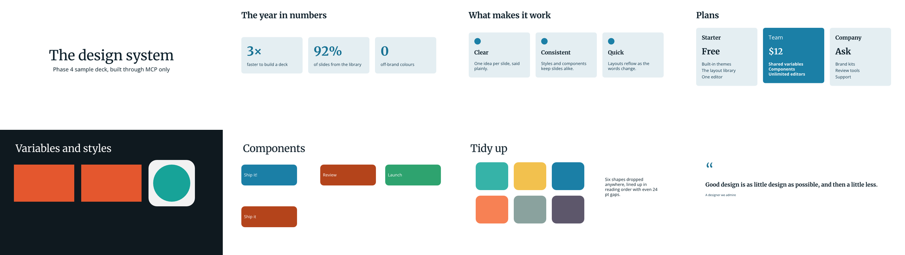
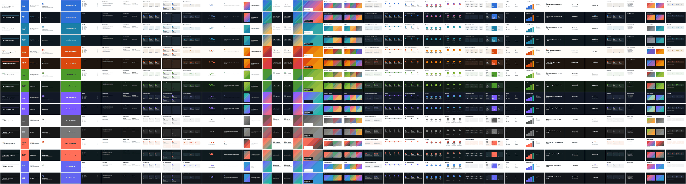

# Phase 4 report: design system

> **Date:** 2026-11-25 · **Branch:** `claude/phase-4-design-system` (from `claude/phase-3-canvas` at
> `ae5b4fa`, with `claude/new-session-lm99ab` at `075c17b` merged in) · **Commits:** `ec31b75`
> (P4.1) · `1e17582` (P4.2–P4.3) · the commit with this report (P4.4, the sample deck, the
> contact sheet, the bench step and the docs)

## 1. What shipped



Every feature below is a command (so the GUI, CLI, control channel and MCP reach it), is one undo
step, is saved in `.deckcraft`, and round-trips through `.pptx`. Every new field is absent unless
used: existing decks and `.pptx` files are unchanged, and every earlier golden picture is
byte-identical.

| Arc | What | Commands | GUI |
|---|---|---|---|
| P4.1 | **Variables with modes and aliases.** Collections with modes (Light/Dark, Calm/Bold…); colour, number, string and boolean variables; aliases (chains bounded, cycles refused). The deck has a mode per collection and a slide may use another. Colours bind through a new colour base that names a variable and is resolved when drawn; a colour variable may drive one of the theme's 12 slots, a string variable the heading or body font. Number, string and boolean bindings: corner radius, gap, cross gap, padding, width, height, outline width, font size, font family, text, visibility | `variable.createCollection`, `renameCollection`, `deleteCollection`, `addMode`, `renameMode`, `deleteMode`, `create`, `set`, `delete`, `mode`, `bind`, `unbind`, `list` (query); colour params take `{variable: id}` | View ▸ Variables pane |
| P4.2 | **Paint, effect and grid styles**; paragraph and character styles (Phase 2) bound to variables. A changed style restyles every shape that uses it; editing a shape's fill another way detaches it, as in Figma. Grid styles are drawn over a slide or frame while editing | `designStyle.create`, `update`, `apply`, `delete`, `list` (query), `style.bind` | View ▸ Assets pane ▸ Styles; canvas overlay |
| P4.3 | **Components, variants, properties, instances, overrides, swap.** A main can sit on a slide and is edited with every tool; every instance follows and keeps its overrides. Typing into an instance, or changing a layer's fill or visibility, becomes an override. Text, boolean and instance-swap properties; component sets with variant properties; variant switch and swap carry overrides by layer name | `component.create` (Cmd/Ctrl+Alt+K), `update`, `addProperty`, `removeProperty`, `delete`, `editMain`, `insert`, `list` (query); `instance.set`, `swap`, `override`, `reset`, `detach` | Assets pane (components by set, Place, Go to Main, the selected instance's properties, variant, swap, reset, detach); Arrange menu |
| P4.4 | **Themes on variables, a 34-layout library, Tidy up.** Every built-in theme as a `Theme` collection with Light and a derived Dark mode (12 colours and 2 fonts mapped to the theme, semantic colours, spacing, radius and type scales). 34 library layouts built from frames, auto layout, the kit's variables and nine library components (two of them variant sets). Tidy up lines a messy selection up in reading order in an auto layout grid with even gaps | `design.kit`, `slide.fromLibrary`, `slide.library` (query), `arrange.tidy` (Ctrl+Alt+T) | Variables pane ▸ Theme Variables; Assets pane ▸ Layouts; Arrange ▸ Tidy Up |

The library's layouts: Title, Title with Band, Section, Section Band, Agenda, Title and Bullets,
Two Columns, Three Up, Four Up, Three Stats, Big Number, Quote, Quote with Image, Image Left,
Image Right, Full-Bleed Image, Two Images, Gallery, Comparison, Timeline, Process, Team, Team
with Bios, Logo Wall, Pricing, Key Facts, Chart and Takeaways, Statement, Questions, Closing,
Contact, Checklist, Before and After, Dashboard.

**How the pieces fit.** The deck's design system (`Presentation::design`) is one `Arc`, shared
between undo steps. After every edit, next to Phase 3's canvas pass, the engine's design pass
(`crates/engine/src/design_system.rs`):
1. keeps every master's theme equal to the theme-mapped variables in the deck's modes (or, when a
   theme command changed the theme, takes the new theme into the active mode);
2. writes text-style bindings into the deck's text styles;
3. writes changed paint and effect styles into the shapes that use them, and drops the link of a
   shape whose look was changed some other way;
4. writes number, string and boolean bindings into their fields, on the slides that have bindings,
   then lets auto layout reflow;
5. copies a main edited on a slide into the library and rebuilds every instance of a changed
   component (and every instance on an edited slide, turning edits into overrides); text in
   rebuilt instances is fitted to its box so the layout reflows.

Colours are never written: they resolve when the slide is drawn (`resolve::Ctx::color`), as theme
colours do. A Light/Dark switch therefore changes one value and copies no slide (tested).

**The sample deck**, [`samples/phase-4.deckcraft`](../../samples/phase-4.deckcraft), is built
only by MCP `tools/call` requests (`crates/mcp/tests/it/phase4_sample.rs`): the Harbor theme as
variables; three library slides (stats, feature cards, pricing with a highlighted variant); a
brand collection bound to shapes, a paint style on a colour variable, a radius variable on a frame
and a grid style, on a slide shown in other modes than the deck; a component set with a text
property, two instances, an override, a variant switch and an edit of the main; Tidy up; a library
quote. The test checks that the stored file is what the script builds, that two runs agree, and
that each feature is in the saved deck. It renders headlessly:

```bash
deckcraft-cli render samples/phase-4.deckcraft --all --scale 1 out/
```

**Design check** (brief §5). The contact sheet below has one row per built-in theme and mode
(DeckCraft, Harbor, Ember, Meadow, Nocturne, Paper, Coral Reef, Slate; Light above Dark) and one
column per library layout, in the order listed above: 544 slides.



`crates/engine/tests/it/contact_sheet.rs` builds the same 544 slides on every CI run and checks
each one: every text box is tall enough for its text, every visible object is on the slide and
inside its frame, and every run of text has WCAG AA contrast against what is drawn behind it
(4.5:1; 3:1 for 18 pt, or 14 pt bold). All 544 pass. Getting there found and fixed:
- small accent-coloured captions reached only 3:1 (now the kit's `color/accent-text` reaches
  4.5:1 on both backgrounds);
- Nocturne's "Light" mode has a dark background, and the kit pushed its accent text towards
  black (the push now follows the background's luminance, not the mode's name);
- the highlighted price tier's list reached 4.47:1 on Slate's accent (it is now bold, which is
  large text under WCAG);
- feature-card icons, step badges and check marks were stretched into pills by their card's
  layout; the timeline's badges were then too small for "Q1" (both fixed, found on the sheet).

The full gate found one more bug before the P4.4 commit: the kit was recognised by its collection
name, so Design ▸ Themes overwrote a deck's own collection called "Theme". The kit's collection
is now marked (`Collection::kit`), with a regression test.

I also looked at every slide of the sample deck before blessing its golden pictures, and at
kittest renders of the Variables and Assets panes. Two problems were fixed that way: a sample
badge with white text on yellow (my script's colour), and a quote mark at big-number size that
left a gap above the quote.

## 2. Ported and re-implemented

`craft-libs` has no variables, styles, components or layout crate. FigCraft's variables and
components live on its `imbl` node store (MPL-2.0, outside the allowlist), so nothing was lifted;
FigCraft was the behavioural reference. Details are in [`porting-log.md`](../porting-log.md).

- **Re-implemented against the host model, as decision 002 says:** variables, collections, modes
  and aliases (`deckcraft_model::variables`); paint, effect and grid styles
  (`deckcraft_model::design_styles`); components, variants, properties, instances and overrides
  (`deckcraft_model::component`, materialisation a pure function with tests); Tidy up.
- **Built here:** the theme kit (`deckcraft_model::design_kit`: the Dark modes and the contrast
  rules), the layout library (`crates/engine/src/library.rs`), the design pass, the contact-sheet
  check.
- **Reused from the host:** theme colour resolution (now variable-aware), Phase 2's text styles,
  Phase 3's frames, auto layout and canvas pass, the host's text measuring for fitting text boxes.

## 3. Tests, benchmarks and round trips

| Check | Result |
|---|---|
| `cargo xtask ci` (fmt, pdf-deps, clippy, test, doctest, assets, layers, wasm) at each arc's commit | All 8 steps passed at `ec31b75` (P4.1), `1e17582` (P4.2–P4.3) and the P4.4 commit; 2,523 tests (test and doctest steps), 0 failed, at the last (2,476 at the end of Phase 3) |
| Fork patch tests | Pass (part of the above) |
| Golden images | Pass. 8 new Phase 4 pictures; every built-in, Phase 1, 2 and 3 picture byte-identical |
| `.pptx` round trip of the five sample decks, by structure and pixels | Pass, Phase 4 deck included |
| `.pptx` round trip of the Phase 4 fields | Variables, slide modes, bindings, colour variables, styles, grid styles, components, instances and mains survive `.deckcraft` and `.pptx` (engine tests for each arc); PowerPoint sees resolved colours, the active mode's theme and instances as ordinary groups |
| The design check (contact sheet) | 544 slides, 0 problems (overflow, clipping, WCAG AA) |
| The ten real-world decks | **Not run in this session** (the corpus is not in this container). Phase 4 writes nothing new for decks without Phase 4 fields |
| Every new feature reachable from MCP | The sample deck is built from MCP calls only |
| Hostile input | Tests for each arc: wrong types, unknown ids and modes, alias cycles, over-long names and lists, NaN and huge numbers, self-nesting components (bounded at depth 8), damaged extensions; every refused command leaves the deck as it was |

**Performance**, release build, 4-vCPU Linux container, `deckcraft-cli bench --runs 9` on a deck
of 103 slides: the title slide and the 34 library layouts three times, Harbor theme kit, 156
component instances:

| Step | Median | Budget |
|---|---|---|
| Open (including the canvas and design passes) | 23.9 ms | 1,500 ms ✔ |
| **Variable mode switch across the deck** (the Theme collection, Light ⇄ Dark) | **9.3 ms** | **100 ms ✔** |
| Mode switch and drawing all 103 slides at 1× | 163 ms | — |
| Draw all 103 slides at 1× | 134 ms | — |
| Save / reopen `.pptx` | 27.9 / 40.3 ms | — |
| Move one shape (one undo step) | 1.9 ms | — |
| Restyle every slide (theme accent) | 0.7 ms | — |

The mode switch copies no slide; its 9 ms is the design pass checking the deck's bindings and
library. 60 fps pan and zoom can't be measured here (no display, software GPU), as in Phases 1–3.

## 4. Known gaps and risks

**Limits of what shipped:**
- **Modes** can be set for the deck or a slide, not for a frame (FigCraft allows a frame).
  Colour variables follow a slide's mode everywhere; theme fonts follow the deck's mode only.
- **Number, string and boolean bindings** are written into the field (they drive layout), so a
  mode switch that changes them copies the slides that use them. Colours never copy a slide.
- **Instances:** overrides cover text, fill and visibility. Other edits inside an instance
  (moving or resizing a layer) are undone by the next rebuild: geometry follows the component.
  Instance text boxes are fitted to their text when rebuilt, so a long override grows the card.
- **Components** have no slots or nested auto layout "instance swap" UI beyond the swap
  property; component descriptions and variant names are free text.
- **The layout library** makes slide content on the Blank layout, not master layouts with
  placeholders (§5, decision 1). Pictures are gradient stand-ins. Several layouts leave the lower
  third of the slide empty (content is top-aligned); the check passes, but a designer would
  balance them.
- **Theme ↔ variables:** the kit's variables drive every master's theme. A deck with two masters
  of different themes gets both overwritten by the kit's values.
- **Grid styles** are shown, not snapped to (snapping and Tidy up do not use them yet).
- **What PowerPoint shows:** resolved colours (`srgbClr`, not `schemeClr`, for colours bound to a
  variable), the active mode's theme, instances as groups, styles as direct formatting. SlideCraft
  reads all of it back from its extensions.
- **Tidy up** works on unrotated objects in the same group or frame.

**Risks for Phase 5:**
- Smart Animate matching by stable id: instance layers keep their ids across rebuilds (the map),
  which helps; library slides made twice have different ids, so matching across them needs names.
- The design pass rebuilds, and refits the text of, every instance on a slide each time that
  slide is edited. Moving one shape on the 103-slide bench deck takes 1.9 ms, but a slide with
  hundreds of instances has not been measured.
- **craft-pptx slots** (decision 004): Phase 4 needs no new slot. Its data rides in the
  presentation (`sc:design`), slide (`sc:modes`) and shape (`sc:canvas`) extensions already listed
  in [`upstream/craft-libs-fork-plan.md`](../upstream/craft-libs-fork-plan.md) §3 step 3 (lines
  added there). The group-level `cNvPr` slot from the Phase 3 report matters more now: instances
  and mains are groups.

## 5. Decisions for the owner

1. **Library layouts as slide content, not master layouts.** Recon §4.2 proposed layouts whose
   placeholders sit inside auto layout frames. PowerPoint keeps a layout's placeholders at its top
   level, and the frames are what make the layouts reflow, so `slide.fromLibrary` builds slide
   content on the Blank layout. Say if you want master layouts too (they would not reflow).
2. **The Dark modes** are derived by rule from each theme (deep background in the theme's hue,
   light text, accents lifted to AA). Say if any theme should get a hand-tuned Dark palette.
3. **One combined commit for P4.2–P4.3** (they share the design pass), as in Phase 3.
4. **ROADMAP.md and the parity docs** (upstream DeckCraft's) were not updated, as in Phases 2–3;
   SlideCraft's progress is in `docs/HANDOFF.md` and the reports.
5. Still open from before: shared crates, collaboration, the image-generation bridge, the
   installer identity step, the craft-libs issue's group-level slot, and the 2026-12-14 date in
   decision 004.
